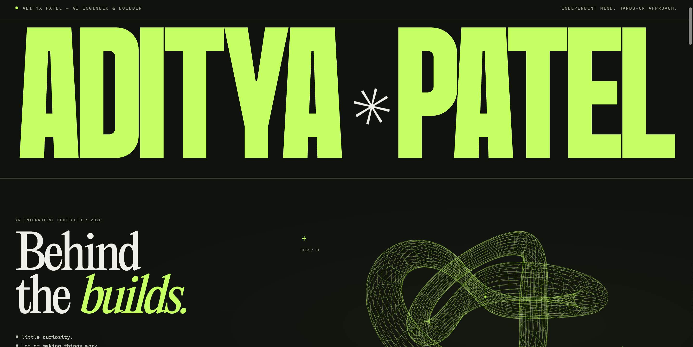
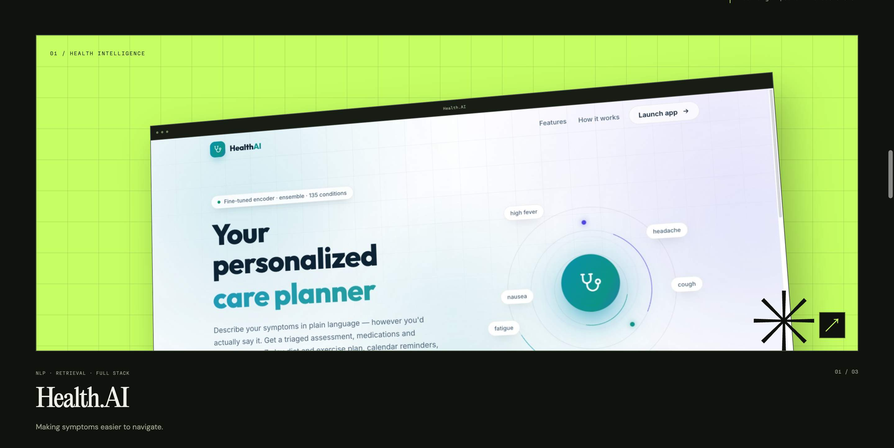
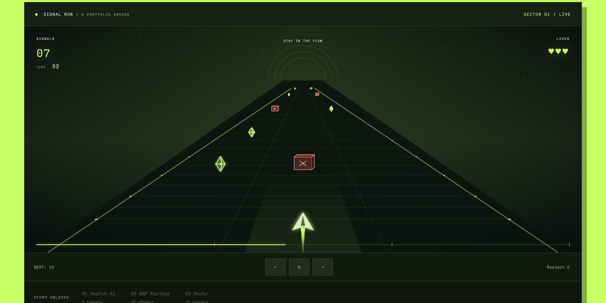
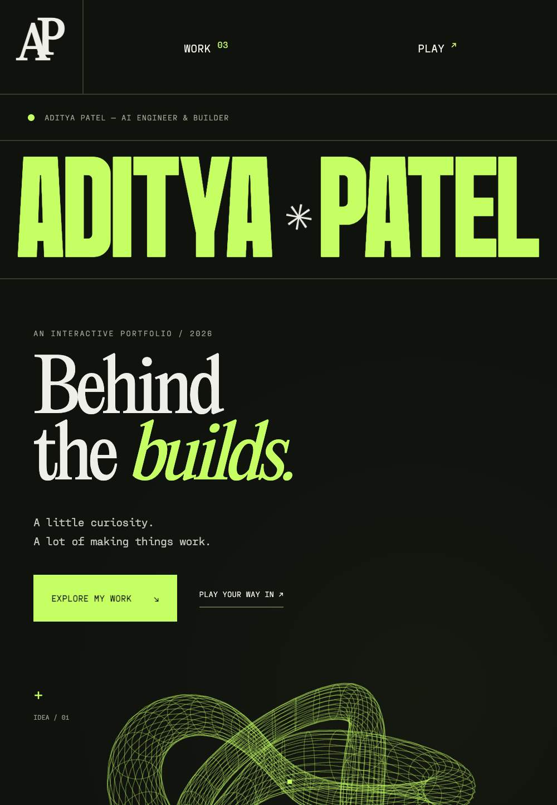

# Wisper Flow Challenge

An interactive portfolio by **Aditya Patel**, built around a simple idea: let people explore the work, the thinking behind it, and a little play along the way.

The experience combines oversized typography, a dark-and-lime visual identity, a rotating 3D wireframe sculpture, project stories, and **Signal Run**, a small arcade game that unlocks those stories as you play.

[Explore the source](https://github.com/adipatel399/Wisper-Flow-Challenge) · [Aditya’s main portfolio](https://adipatel399.github.io/) · [LinkedIn](https://www.linkedin.com/in/aditya399/)

## UI preview

### Desktop — behind the builds

A large typographic introduction paired with a draggable, animated wireframe knot.



### Selected work

Project previews use perspective, pointer-responsive motion, and focused story dialogs.



### Signal Run

A three-lane flight game with glowing rails, crystal pickups, obstacle crates, and a banking ship.



### Mobile

Layouts adapt to smaller screens, with touch buttons and swipe steering for the game.



## What’s inside

- **Interactive hero:** a Canvas-rendered 3D wireframe knot that rotates over time and responds to dragging.
- **Project stories:** Health.AI, the BNP Paribas internship, and Rocky, presented with technical context and relevant links.
- **Project previews:** real application imagery, layered compositions, and subtle pointer-driven perspective on supported devices.
- **Portfolio arcade:** a complete game with a timer, lives, collectibles, obstacles, streaks, pause/resume, replay, and project unlocks.
- **Responsive interface:** desktop and mobile layouts, keyboard focus indicators, native story dialogs, and reduced-motion handling.
- **Local best score:** the game remembers a player’s best result in their browser when local storage is available.

## Featured work

| Work | Focus | What the story covers |
| --- | --- | --- |
| **Health.AI** | NLP, retrieval, full-stack development | Natural-language symptom input, a classification pipeline, semantic retrieval, and the application interface. |
| **BNP Paribas** | AI engineering internship | Workflow automation, retrieval across documents, testing, and operational usefulness. |
| **Rocky** | Voice interfaces and local AI | Local wake-word detection and transcription, intent routing, and a spatial globe interface. |

Project details are presented as portfolio summaries. Internal internship materials are not included in this repository.

## Play Signal Run

Collect the **green crystals** and avoid the **red crates**. A run lasts **45 seconds**, starting with **three lives**. The pace increases during the run, and a short grace period after a collision prevents immediate repeated damage.

| Control | Action |
| --- | --- |
| `←` / `→` or `A` / `D` | Move between lanes |
| On-screen arrow buttons | Steer on touch devices |
| Horizontal swipe across the game | Steer left or right |
| `Space` or the middle control | Pause or resume |
| Restart / Fly again | Start a fresh run |

### Story unlocks

| Signals collected | Story unlocked |
| --- | --- |
| 5 | Health.AI |
| 10 | BNP Paribas |
| 15 | Rocky |

All three stories are also accessible directly from **Selected Work**. Playing is optional. Unlock progress resets for each run; the best score is saved locally in the browser.

## Run locally

This is a static website. **No package installation, API keys, or build step is required.**

### Requirements

- A modern browser with JavaScript and Canvas support.
- Python 3, or another static HTTP server.

### Quick start

```sh
git clone https://github.com/adipatel399/Wisper-Flow-Challenge.git
cd Wisper-Flow-Challenge
python3 -m http.server 4173 --bind 127.0.0.1 --directory dist
```

Open **http://127.0.0.1:4173**. Stop the server with `Ctrl+C`.

Use a local HTTP server for a consistent preview. The main images and custom fonts are bundled; the stylesheet also requests supplementary fonts from Google Fonts.

## Technology

| Layer | Implementation |
| --- | --- |
| Page structure | Semantic HTML |
| Layout and styling | CSS Grid, Flexbox, media queries, custom properties |
| Interactions | Plain JavaScript and native browser APIs |
| Graphics | Canvas 2D with custom 3D projection |
| Animation | `requestAnimationFrame` and CSS |
| Best-score persistence | Browser `localStorage` |
| Runtime | Static files; no application backend |

The spatial effects are implemented directly in the browser without a 3D framework or game engine.

## Repository structure

```text
Wisper-Flow-Challenge/
├── README.md
├── docs/
│   └── screenshots/       # Desktop, project, game, and mobile captures
└── dist/
    ├── index.html         # Page sections and project markup
    ├── style.css          # Visual system and responsive layouts
    ├── app.js             # Project stories, sculpture, and game logic
    └── assets/            # Local fonts and project images
```

## Customization

- **Page content and links:** edit `dist/index.html`.
- **Project story text:** edit the `stories` object in `dist/app.js`.
- **Colours, typography, and layouts:** edit `dist/style.css`.
- **Game behavior:** update the game state, `updateGame`, and rendering functions in `dist/app.js`.
- **Images and fonts:** replace or add files in `dist/assets/` and update their references.

After changes, refresh the browser. A JavaScript syntax check is available with Node.js if installed:

```sh
node --check dist/app.js
```

## Deployment

Serve the contents of **`dist/`** using a static hosting service. Keep the asset paths intact and use `dist/index.html` as the entry point. No server-side environment variables or database setup is needed.

## Author

**Aditya Patel** · [GitHub](https://github.com/adipatel399) · [LinkedIn](https://www.linkedin.com/in/aditya399/) · [Portfolio](https://adipatel399.github.io/)
